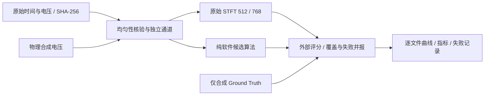

# TASK-008 冻结实验协议

本任务只在 Research 内探索。参数开发使用 `development00/01/02`，保留原型失败；最终评价使用新种子，不根据最终结果改参数。源码冻结清单为 `source_freeze.json`，运行环境为 `environment.json`。

## 🧭 科学问题与边界

采用单通道实值模型 $x(t)=H_{AC}\{A(t)\cos[\phi_0+2\pi\int_0^t f(\tau)d\tau]\}+b(t)+u(t)+w(t)$。合成指定真空波长 1550 nm，$v_{app}=\lambda f/2$；真实记录没有核验波长、参考频移或窗口折射标定，因此真实图中仅给 **1550 nm 假设下的等效表观速度**。所有 corrected velocity 数组为 NaN。原始数据不修改、不重采样、不丢样本。

实值、无参考频移模型不辨别速度符号；AC 耦合下无拍频不等于零速。静止、低频不可测、消光、目标身份歧义分别记录。所有有限轨迹是研究假设，`accepted_hz` 也只表示通过启发式波形支持门槛，不能称为已验证测量。

## 🧪 输入全集与注册分布

递归遍历 `data/raw`，所有 `.csv` 和不含 `result` 的 `.dat` 均进入尝试清单。处理结果、图片和占位文件列入排除清单。当前实际读取 13 文件、17 电压列；通道不是独立实验次数。全部列逐条处理，不挑案例，不按图形质量丢数据。所有文件（包括排除的辅助文件）任务前后做 SHA-256 核验。

| 角色 | 独立波形 | 生成条件 |
| --- | ---: | --- |
| development00 | 12 | 每族第 0 条；初版源码归档于 development_sources00 |
| development01 | 48 | 12 族 × 4，重用开发种子；修正粗频率中的 DC 混淆 |
| development02 | 12 | 重用第 0 条；加入相干杂散投影、显式 DC 极点 |
| fresh | 96 | 12 族 × 8，seed=81100000+1000×族编号+实例 |
| phase_stress | 50 | 新随机初相；seed=81200000+实例，低速专门压力评价 |

主分布每条 12,800 点、40 GS/s、320 ns。12 族为阶跃、低速爬升、强加速、快速卸载、双冲击、-5 dB 弱信号、完全/部分消光、强持续杂散、近邻双分量、散斑相位跳变、有色噪声、纯噪声。每族的 AC 截止按实例轮换 0/2/15/50 MHz，8 条中每档 2 条，起跳位置和初相独立随机。除弱信号与有色噪声外，注入白噪声的目标名义 SNR 为 12 dB；此定义不含杂散和有色分量，不能转用作真实实验 SNR。

50 条压力波形在 15/30/50/100/200 m/s、8/16 dB、0/2/15/50 MHz 中按实例模数分配，每速度 10 条。**这是联合压力分布，不是每个速度/截止/SNR 单元各 50 次试验，也不是能独立估计所有交互作用的全因子设计。** 不能用这些样本证明每个条件均稳定。无 80 GS/s 合成完整统计；80 GS/s 两个真实文件按实测采样率原样计算。

## ⚙️ 对照与算法配置

原基准直接调用已有 `compute_stft -> extract_peak_ridge -> refine_peak_ridge_subbin`：Hann 512/384/4096 与 768/640/4096，原频带 0.05–6 GHz，无 detrend、boundary 或 padding。离散最强峰与 refined 输出同时保存，原 refinement 失败为 NaN，不伪造回退。

另有 5 MHz–8 GHz 的原 STFT 控制，以及 256/512 点局部去均值＋能量事件截断控制。复杂算法的净收益必须与这些控制比较，不能把去 DC、频带或先验截断的收益归给非线性优化。所有方法输出相同原始样本索引中心 384+128k；原 STFT 的额外边缘帧仅不进入共同评价网格，完整 raw 仍用于计算。40 GS/s 的速度曲线网格为 3.2 ns，80 GS/s 为 1.6 ns，不声称速度历程具有 25 ps 时间分辨率。

共同起跳检测使用未经滤波原电压的 16 点块能量、首 10%（最多 4096 点）的背景尺度、两块确认和局部双方差代价细化。首段静止是条件性假设，不把返回的事件时刻称为已确认物理起跳。VarPro、Dechirp、ACMD、短窗控制、矩阵束、时域与基带共用该事件检测，起跳得分相同不是多个独立证据。原 STFT 对照使用窗中心幅度门槛，保留提前响应和漏检。杂散投影组合在其显式残差信号上重新检测。

具体参数以每个算法文件夹 `parameters.json` 和 `implementation.py` 为准。不使用真值给算法初始化、不把某条真实谱带指定为目标、不补 NaN。粗轨迹的线性评价仅初始化连续频率模型，不对原电压重采样；FIR/SG/二阶惩罚等显式算法算子分别记录。ACMD 是单模态研究变体，矩阵束是 LS 子空间移位变体，时域是确定性分段正则最小二乘；不冒充完整原论文算法、TLS 或校准的贝叶斯后验。

## 📏 评分定义与成本

真值只进入 `runner.score`，不能进入估计器。运动段从真实起跳到记录结束，包含消光；静止段不并入运动 RMSE，也不以先验零值刷低误差。分别计算全运动、起跳后 40 ns、已知快变邻域及低速区域。频率到速度按同一指定波长换算。

- 有限 RMSE = 有真值且输出有限点上的平方误差均方根，必须并列有限数/目标总数。
- 覆盖率 = 有限输出数 / 全部有真值点；缺失不能从分母删除。
- 失败率 = (|误差|>100 MHz 的有限点 + 缺失点)/全部有真值点；同时保留 50/200 MHz 阈值敏感性。100 MHz 对应 77.5 m/s。
- 原始候选与 `accepted_hz` 分别评分，防止复杂门槛仅靠拒绝降低有限 RMSE；静止和完全消光的有限 accepted 输出单列。
- 起跳报告有符号误差、绝对误差分位数、漏检数，以及纯噪声假事件数，不只报告检测成功子集的均值。
- 真实数据没有 RMSE/正确率。覆盖、残差解释率、窗间差异和跳变数均是观测诊断，不能代替目标身份或真实精度。杂散残差上的解释率与原波形上的解释率分开标注。
- 统计按独立合成波形进行配对 bootstrap（2000 次、seed=81300001），不把重叠帧或同文件通道视为独立实验。主比较为全分母失败率与覆盖率，有限 RMSE 单独标注缺失选择影响。
- `perf_counter` 记录单线程 BLAS 的公共 setup、算法和两者和，导出/画图不计时；setup 也包含某些基准无需的粗初始化，故这些是当前统一 harness 成本，不能视为各算法最优实现的下界。不得根据 320 ns 合成耗时直接推算 80,000 点耗时；报告真实 80k/200001 点实测。

## 🔎 预先指定的图形与止损解释

每个方法、每条真实通道保存全记录图和原始轨迹。合成图固定每族第 0 条及全体指标热图，失败、漏检和 NaN 不隐藏；最差实例另列诊断，不能替换固定代表图。50 次初相压力只作分布评估，不再调参。

本轮不执行 Production 准入。复杂方法若相对两个短窗控制没有可靠净增益、对起跳/杂散/消光有明显失败，仍完整归档。附件中 0.15 ns、95.5%、稳定半周期无偏、任意双分量可分与秒级后验等数字均不采信；只有本轮实际运行产生的量化结果进入结论。
